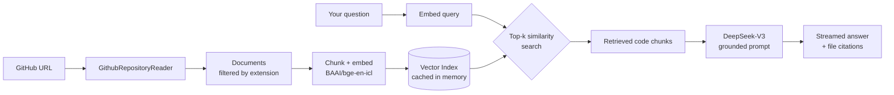

# RepoGPT

### Stop reading code. Start asking it questions.

Paste any GitHub repository URL and have a real conversation with it — architecture,
data flow, "where does X happen", "how do I add Y". Retrieval-augmented generation
built on **LlamaIndex**, **Nebius AI embeddings**, and **DeepSeek-V3**.

## The problem

You land on an unfamiliar repository with 400 files and a README that says
*"see the docs"*. The docs are stale. `grep` gives you 90 hits with no ranking and
no explanation. Onboarding onto a mid-size codebase eats days — not because the code
is hard, but because **finding the relevant 200 lines is hard**.

Large language models can explain code beautifully, but they can't hold a whole
repository in their head, and they confidently invent functions that don't exist.

**Codebase Q&A RAG closes that gap.** It indexes a repository into a semantic vector
space, retrieves only the passages that actually matter to your question, and hands
those to an LLM that is instructed to answer *from the retrieved code and cite the
files it used*. You get a grounded answer with file paths you can go read yourself.

---

## ✨ What it does

| | |
|---|---|
| 🔗 **Any public repo, one URL** | Paste `https://github.com/owner/repo` — or a `/tree/branch` URL to target a specific branch. |
| 🧩 **26 languages indexed** | Python, JS/TS, Java, Go, Rust, C/C++, C#, Ruby, PHP, Swift, Kotlin, SQL, notebooks, plus Markdown/YAML/TOML config. |
| ⚡ **Index once, ask forever** | The vector index is cached on `owner/repo@branch`. Follow-up questions skip embedding entirely and answer in seconds. |
| 📡 **Token-by-token streaming** | Answers stream into the chat as they're generated — no staring at a spinner. |
| 📎 **Every answer cites its sources** | An expandable *Sources* panel lists the exact files retrieved for that answer. |
| 🎛️ **Tunable retrieval** | A `top-k` slider trades breadth of context against latency and token cost. |
| 🔐 **Bring your own keys** | Keys are typed into the sidebar and held in session state only — never logged, never persisted, never committed. |
| 💾 **Export answers** | Download any response as Markdown to drop straight into your notes or a PR description. |

---

## 🏗️ How it works



**The five stages, concretely:**

1. **Ingest** — `GithubRepositoryReader` walks the repo tree over the GitHub API with
   5 concurrent requests, keeping only source and documentation extensions.
2. **Embed** — every document is chunked and encoded with Nebius-hosted
   `BAAI/bge-en-icl`, a retrieval-tuned embedding model.
3. **Index** — vectors land in an in-memory `VectorStoreIndex`, memoised by
   `@st.cache_resource` so a Streamlit rerun never re-pays the embedding cost.
4. **Retrieve** — your question is embedded into the same space; the *k* nearest
   chunks are pulled back as context.
5. **Synthesise** — a custom prompt hands DeepSeek-V3 only those chunks and instructs
   it to cite file paths and to say *"not in the context"* rather than hallucinate.

### Why the caching matters

The naive version of this app rebuilds the vector index on **every question** — a repo
with 300 files means 300 files re-embedded per message, turning a 2-second answer into
a 60-second one and multiplying your embedding bill by the length of the conversation.
Here, ingestion and index construction are cached separately on repo identity, so the
cost is paid exactly once per repository.

---

## 🚀 Try it

**[📖 Project page](https://tirth1263.github.io/Codebase-QnA-RAG/)** — architecture and
feature walkthrough.

Whether you run it locally or on a hosted instance, you'll need two free credentials:

| Key | Where to get it | Why |
|---|---|---|
| `NEBIUS_API_KEY` | [studio.nebius.ai](https://studio.nebius.ai) | Powers both the embedding model and DeepSeek-V3. Free credits on signup. |
| `GITHUB_TOKEN` | [github.com/settings/tokens](https://github.com/settings/tokens) | Lifts the API rate limit from 60 to 5,000 requests/hour, and unlocks private repos you own. Read-only, public-repo scope is enough. |

---

## 💻 Run it locally

### macOS / Linux

```bash
git clone https://github.com/tirth1263/Codebase-QnA-RAG.git
cd Codebase-QnA-RAG

chmod +x setup.sh
./setup.sh                 # creates ~/.venvs/codebase_qna_rag and installs deps

nano .env                  # add NEBIUS_API_KEY and GITHUB_TOKEN

source ~/.venvs/codebase_qna_rag/bin/activate
streamlit run main.py
```

### Windows (PowerShell)

```powershell
git clone https://github.com/tirth1263/Codebase-QnA-RAG.git
cd Codebase-QnA-RAG

powershell -ExecutionPolicy Bypass -File setup.ps1

notepad .env               # add NEBIUS_API_KEY and GITHUB_TOKEN

& "$HOME\.venvs\codebase_qna_rag\Scripts\Activate.ps1"
streamlit run main.py
```

The app opens at `http://localhost:8501`. The `.env` file is optional — you can paste
both keys directly into the sidebar instead.

---

## 🗂️ Project structure

```
Codebase-QnA-RAG/
├── main.py                 # the whole application: ingest → index → retrieve → answer
├── requirements.txt        # pinned dependency floor
├── setup.sh                # one-command environment setup (macOS/Linux)
├── setup.ps1               # one-command environment setup (Windows)
├── .env.example            # credential template
├── .streamlit/config.toml  # dark theme + server settings
└── README.md
```

`main.py` is deliberately kept to a single readable file. The pieces worth reading:

- `parse_github_url()` — URL → `(owner, repo, branch)`, with a real error message on
  malformed input instead of a stack trace.
- `load_repository()` — cached GitHub ingestion.
- `build_index()` — cached embedding + index construction, keyed on `owner/repo@branch`.
- `QA_PROMPT` — the grounding prompt that forces citations and permits "I don't know".
- `answer()` — one retrieval + streaming-synthesis pass.

---

## 🧪 Questions that work well

Once a repo is indexed, these give genuinely useful answers:

> *What does this project do, and how is it structured?*
> *Where is authentication handled, and which middleware enforces it?*
> *Trace the data flow from an incoming HTTP request to the database write.*
> *What would I need to change to add a new API endpoint?*
> *Which parts of this codebase have no test coverage?*
> *Explain the caching strategy used here and why.*

---

## 🛠️ Tech stack

| Layer | Choice | Why |
|---|---|---|
| **Orchestration** | [LlamaIndex](https://www.llamaindex.ai/) | Batteries-included RAG primitives — readers, chunking, vector index, query engines. |
| **Ingestion** | `llama-index-readers-github` | Walks the GitHub tree API concurrently; no local clone needed. |
| **Embeddings** | `BAAI/bge-en-icl` via Nebius | Strong retrieval performance on technical text, served cheaply. |
| **LLM** | `deepseek-ai/DeepSeek-V3` via Nebius | Excellent code reasoning at a fraction of frontier-model pricing. |
| **UI** | [Streamlit](https://streamlit.io) | Native chat components, streaming, and resource caching in pure Python. |
| **Hosting** | Hugging Face Spaces | Free, public, container-backed Streamlit hosting. |

---

## 🧭 Roadmap

- [ ] Persistent vector store (Qdrant / Chroma) so indexes survive restarts
- [ ] AST-aware chunking that splits on function and class boundaries
- [ ] Hybrid retrieval — BM25 keyword search fused with dense vectors
- [ ] Reranking pass over retrieved chunks before synthesis
- [ ] Direct links to the exact line ranges on GitHub in the sources panel
- [ ] Multi-repo indexing to answer questions across a whole organisation

---
