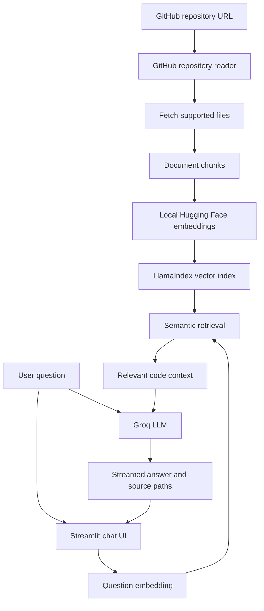

# RepoGPT — AI-Powered GitHub Repository Q&A

**Understand an unfamiliar codebase by asking questions in plain English.**

RepoGPT is a Streamlit application that helps developers explore GitHub repositories without manually opening and searching through every file. It retrieves relevant code context with semantic search, then uses a Groq-hosted language model to explain how the project works and points you toward the source files used in the answer.

<p align="center">
  <a href="https://repogpt-n58ndw9ykzbamjjtayaza8.streamlit.app/">
    
  </a>
  <a href="https://github.com/dikshaforsure/RepoGPT">
    
  </a>
</p>

<p align="center">
  
  
  
  
  
</p>

## 🚀 Try the live demo

**[Launch RepoGPT on Streamlit Community Cloud](https://repogpt-n58ndw9ykzbamjjtayaza8.streamlit.app/)**

To use the app, provide a GitHub repository URL and your own Groq API key and GitHub token in the sidebar. Index the repository, then ask questions about its architecture, files, and implementation. You can also run RepoGPT locally by following the setup guide below.

> **Privacy reminder:** Only analyze code you are permitted to share with the selected LLM provider. Do not enter API keys into untrusted sites, and never commit tokens to Git.

## 💡 Why RepoGPT?

When joining a project, contributing to an open-source repository, debugging an unfamiliar application, or preparing for a technical interview, understanding a codebase can take hours. Important behavior may be distributed across routes, services, models, utility functions, and configuration files.

RepoGPT turns that exploration into a conversation. It indexes supported files from a GitHub repository and retrieves relevant excerpts to help answer focused questions.

### Practical use cases

- **Onboarding to a new codebase:** Get an overview of a project and find the files worth reading first.
- **Understanding architecture and data flow:** Ask how requests move through routes, services, and database-related code.
- **Finding where a feature lives:** Locate the source files related to authentication, API handling, validation, or error handling.
- **Debugging and maintenance:** Use retrieved code context to investigate how a function behaves or where a workflow may fail.
- **Technical interview preparation:** Ask for explanations of design choices, modules, and implementation details in a repository you are studying.
- **Open-source contributions:** Explore an unfamiliar project before choosing an issue or planning a change.

### Example questions

- “What does this project do, and how is it structured?”
- “Where is authentication handled?”
- “Trace the data flow from an incoming request to the database.”
- “Which files are responsible for processing API requests?”
- “Explain the error-handling and retry logic.”
- “Which files should I read first to understand this project?”

RepoGPT helps you navigate code; it does not replace testing, code review, or independent verification of generated explanations.

## ✨ Key features

- **Natural-language repository Q&A** — Ask questions about a GitHub codebase instead of relying only on manual searches.
- **Retrieval-Augmented Generation (RAG)** — Retrieve relevant repository chunks and provide them as context to the language model.
- **Local semantic embeddings** — Use Hugging Face's `BAAI/bge-small-en-v1.5` embedding model locally after its initial download, without a separate embedding API key.
- **Groq-powered answer generation** — Generate answers using a model available to your Groq account.
- **Source-file references** — View the file paths associated with retrieved context to guide follow-up investigation.
- **Streaming responses** — Read generated answers as they arrive.
- **Configurable retrieval** — Adjust how many chunks are retrieved for each question.
- **Bring Your Own Key (BYOK)** — Enter your own Groq API key and GitHub token in the app sidebar or configure them locally through environment variables.
- **Supported-file filtering** — Index supported programming, configuration, notebook, and documentation file types.
- **Lightweight web interface** — Use the application through Streamlit without a separate frontend build.

## 🏗️ How it works



### The RAG pipeline

| Step | What happens |
|---|---|
| 1. Repository ingestion | The GitHub reader fetches supported files from the selected repository and branch. |
| 2. Embedding | Hugging Face creates local vector representations for the documents. |
| 3. Indexing | LlamaIndex builds an in-memory vector index from the repository documents. |
| 4. Retrieval | The question is used to retrieve the most relevant chunks; the number of chunks is configurable in the sidebar. |
| 5. Answer generation | The retrieved context and question are sent to Groq for response synthesis. |
| 6. Source inspection | The interface displays associated source-file paths so you can continue checking the repository directly. |

## 🧰 Tech stack

| Component | Technology |
|---|---|
| Language | Python |
| User interface | Streamlit |
| RAG and indexing | LlamaIndex |
| Embedding model | Hugging Face `BAAI/bge-small-en-v1.5` |
| Answer generation | Groq API |
| Repository ingestion | LlamaIndex GitHub reader and GitHub API |
| Configuration | `python-dotenv` and Streamlit session state |

## ⚙️ Run locally

### Prerequisites

- Python **3.11 or 3.12** recommended
- Git
- A [Groq API key](https://console.groq.com/keys)
- A GitHub personal access token with read access to the repository you want to inspect

The embedding model is downloaded on its first use, so the initial run needs additional time, disk space, and memory. Groq model access and rate limits depend on your account.

### 1. Clone the repository

```bash
git clone https://github.com/dikshaforsure/RepoGPT.git
cd RepoGPT
```

### 2. Create and activate a virtual environment

**Windows — Command Prompt**

```bat
py -3.12 -m venv .venv
.venv\Scripts\activate.bat
```

**Windows — PowerShell**

```powershell
py -3.12 -m venv .venv
.\.venv\Scripts\Activate.ps1
```

If PowerShell blocks activation, run this in the same terminal and retry:

```powershell
Set-ExecutionPolicy -Scope Process -ExecutionPolicy Bypass
.\.venv\Scripts\Activate.ps1
```

**macOS / Linux**

```bash
python3 -m venv .venv
source .venv/bin/activate
```

### 3. Install dependencies

```bash
python -m pip install --upgrade pip
pip install -r requirements.txt
```

### 4. Configure credentials

Create a local `.env` file from the example.

**Windows — Command Prompt**

```bat
copy .env.example .env
notepad .env
```

**PowerShell or macOS / Linux**

```bash
cp .env.example .env
```

Add your credentials and optional model settings:

```dotenv
GROQ_API_KEY=your_groq_api_key
GITHUB_TOKEN=your_github_token
GROQ_MODEL=openai/gpt-oss-120b
EMBED_MODEL=BAAI/bge-small-en-v1.5
```

Use a Groq model identifier that is currently available to your account. If the configured model is unavailable, check the [Groq model documentation](https://console.groq.com/docs/models) and update `GROQ_MODEL`.

You can enter the API key and GitHub token through the application's sidebar instead of putting them in `.env`.

**Never commit `.env`, paste secrets into public issues, or hardcode tokens in source files.**

### 5. Start RepoGPT

The following command uses the same port and file-watcher setting as the project's Windows setup:

```bash
python -m streamlit run main.py --server.port 8503 --server.fileWatcherType none
```

Open the local URL printed by Streamlit, normally [http://localhost:8503](http://localhost:8503).

## 🧭 Using the app

1. Open RepoGPT locally or launch the [deployed demo](https://repogpt-n58ndw9ykzbamjjtayaza8.streamlit.app/).
2. Enter your Groq API key and GitHub token in the sidebar, unless you have configured them through local environment variables.
3. Paste a GitHub repository URL. The app supports the default `main` branch and branch-specific URLs in the form `https://github.com/owner/repository/tree/branch`.
4. Select **Index repository** and wait for the files to be processed.
5. Ask a focused question in the chat input.
6. Inspect the source paths shown with the answer and continue with more specific questions.

For the best results, start with one feature or module at a time. Broad questions about very large repositories may need to be split into smaller questions.

## 🔐 Security and limitations

- **Use least privilege:** Give your GitHub token only the read access needed for repositories you intend to inspect.
- **Keep credentials private:** Never commit `.env` or expose API keys in screenshots, logs, or source code.
- **Review data-sharing requirements:** Retrieved repository context is sent to the Groq API for answer generation. Do not submit proprietary or sensitive code unless you have permission and the provider's policies meet your requirements.
- **Treat repository content as untrusted:** Code and comments can contain misleading instructions. RepoGPT's prompt tells the model to treat retrieved repository material as data, not instructions.
- **Verify answers:** Retrieval can miss relevant code, and generated explanations can be incomplete or incorrect. Check the referenced files and run tests before relying on an answer.
- **Session-only index:** The vector index is held in memory and does not persist after the process restarts.
- **Repository size matters:** Fetching and embedding large repositories can take time and local memory.
- **External service dependency:** Answer generation depends on Groq availability, model access, and account limits.

Credentials entered into a deployed application should be treated carefully. The BYOK design does not, by itself, guarantee that credentials are never retained or exposed; protections also depend on the implementation and deployment environment.

## 🛣️ Potential next steps

- Add persistent vector storage so indexing can survive app restarts.
- Improve retrieval with reranking and language-aware chunking.
- Add more precise clickable file and line citations.
- Support multi-repository conversations.
- Expand automated tests for repository ingestion, retrieval quality, and error handling.

---

**RepoGPT makes unfamiliar codebases easier to explore — one question at a time.**

- **Live app:** [repogpt on Streamlit](https://repogpt-n58ndw9ykzbamjjtayaza8.streamlit.app/)
- **Source code:** [dikshaforsure/RepoGPT](https://github.com/dikshaforsure/RepoGPT)
